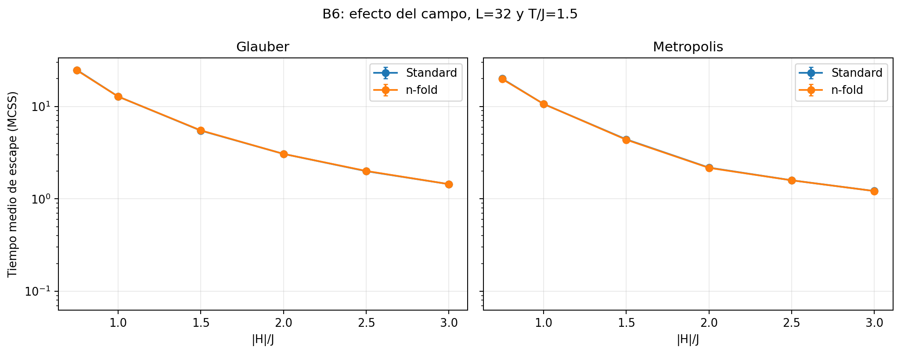
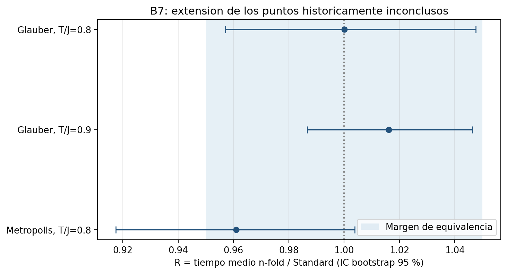
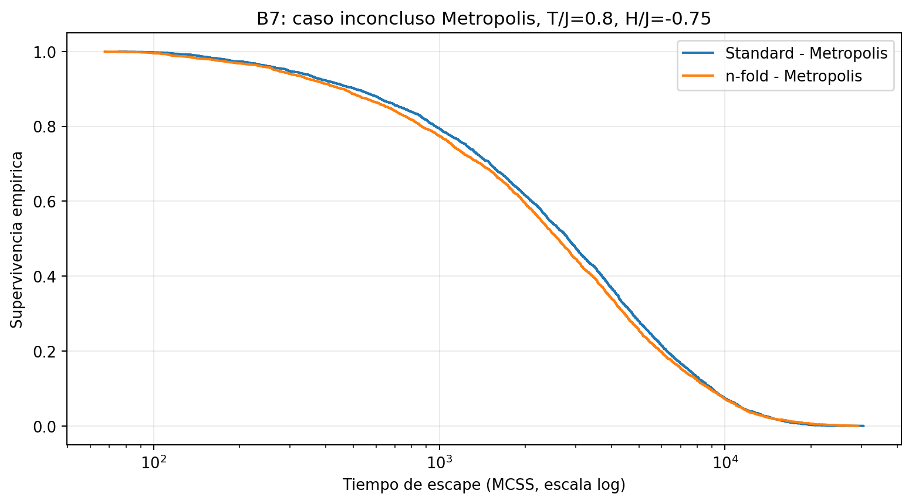

# Resumen ejecutivo

Este proyecto compara **dos maneras de simular una misma dinámica estocástica** del modelo de Ising ferromagnético bidimensional: Monte Carlo Standard, que intenta invertir un espín seleccionado al azar y contabiliza también los rechazos, y **n-fold way**, que elige directamente el siguiente volteo aceptado y adelanta el reloj mediante la distribución geométrica correcta. Para separar la equivalencia algorítmica de las diferencias entre modelos cinéticos, se realizan comparaciones independientes para las reglas de **Glauber/heat-bath** y **Metropolis**.

El observable principal es el **tiempo de primer paso** hasta magnetización total nula, comenzando con todos los espines positivos y aplicando un campo negativo. La práctica tiene dos preguntas: (i) si Standard y n-fold reproducen estadísticas compatibles del tiempo de escape bajo la *misma* regla de transición; (ii) cuándo la eliminación de rechazos compensa el coste adicional de mantener clases y tasas en n-fold.

La release de referencia `v1.0.0` del 30/09/2026 contiene **52 comparaciones de campañas** (44 puntos físicos únicos), con **49 PASS, 3 INCONCLUSIVE y 0 FAIL** para un margen práctico predefinido del ±5 % de la razón de vidas medias. Los bloques B1–B7 han añadido automatización, análisis visual, registro de trazas, animación, barridos de campo y ampliación de las tres condiciones difíciles, conservando congelada aquella release.

**Resultado final del cierre:** en el barrido de campo B6, a $L=32$, $T/J=1.5$, los 12 pares nuevos satisfacen el criterio del ±5 %. En B7, con muestras independientes y mayores, dos de los tres casos anteriormente inconclusos lo satisfacen; el caso Metropolis $T/J=0.8$, $H/J=-0.75$ **sigue siendo INCONCLUSIVE**. Ninguna de estas ampliaciones reescribe el resultado de septiembre. La auditoría B8 valida la integridad de los datos y reproduce los cálculos centrales a partir de los CSV originales.

# Motivación y física del modelo

## Hamiltoniano y variables

Consideramos una red cuadrada periódica $L\times L$, con $N=L^2$ espines $s_i\in\{-1,+1\}$, interacciones ferromagnéticas $J>0$ entre vecinos próximos y campo externo homogéneo $H<0$:

$$
\mathcal H=-J\sum_{\langle ij\rangle}s_i s_j-H\sum_i s_i,
\qquad M=\sum_i s_i,\qquad m=M/N.
$$

Los enlaces se cuentan **una única vez**. El campo negativo favorece la fase $s_i=-1$, mientras que la configuración inicial $s_i(0)=+1$ se encuentra orientada en sentido contrario. A temperaturas bajas, el sistema puede permanecer un largo tiempo en una fase metaestable antes de escapar. Esta espera está asociada al coste de crear interfaces entre dominios; una inversión local pequeña puede retroceder, y una región suficientemente grande puede crecer.

Al invertir $s_i$, únicamente cambian sus enlaces locales y su energía de campo. El incremento exacto de energía es

$$
\Delta E_i=2s_i\left[J\sum_{j\in\operatorname{nn}(i)}s_j+H\right],
$$

de modo que el motor actualiza $E\leftarrow E+\Delta E_i$ y $M\leftarrow M-2s_i$ sin recalcular la red completa en cada evento. Los tests comprueban estas actualizaciones incrementales frente al cálculo directo del Hamiltoniano.

## Observables cinéticos y criterio de parada

La magnitud estudiada es

$$
\tau=\inf\{t\ge0:\ M(t)\le0\}, \qquad
\langle\tau\rangle,\qquad
S(t)=\Pr(\tau>t).
$$

En las redes pares de los experimentos la terminación se produce en $M=0$. Se emplea **MCSS** (*Monte Carlo steps per spin*) como unidad temporal:

$$
t_{\rm MCSS}=\frac{\text{número de intentos equivalentes}}{N}.
$$

MCSS no es un tiempo en segundos calibrado experimentalmente. Tampoco deben inferirse automáticamente observables de equilibrio, como calor específico o susceptibilidad, a partir de las trayectorias absorbentes que terminan al llegar a $M=0$.

# Dinámicas y equivalencia matemática

## Metropolis y Glauber

La probabilidad de invertir un espín propuesto depende de $\beta=(k_B T)^{-1}$ y de $\Delta E$:

$$
p_{\rm Metropolis}(\Delta E)=\min\left(1,e^{-\beta\Delta E}\right),
\qquad
p_{\rm Glauber}(\Delta E)=\frac{1}{1+e^{\beta\Delta E}}.
$$

Ambas reglas satisfacen balance detallado respecto al mismo Hamiltoniano, pero **no son la misma dinámica temporal**. Por ello se comparan exclusivamente Standard–Metropolis con n-fold–Metropolis y Standard–Glauber con n-fold–Glauber. Elegir aleatoriamente un espín en cada intento también es esencial: barrer la red secuencialmente produciría otra regla temporal.

## Las diez clases de n-fold

La energía de inversión depende de la orientación del espín y del número $q\in\{0,1,2,3,4\}$ de vecinos positivos. Como la suma de vecinos vale $2q-4$,

$$
\Delta E(s,q)=2s\,[J(2q-4)+H].
$$

Hay $2\times5=10$ clases. Denotando por $n_k$ la población de la clase $k$, por $p_k$ su probabilidad de aceptación, y por $Q$ la probabilidad de que un intento Standard consiga invertir algún espín,

$$
Q=\frac1N\sum_{k=1}^{10}n_kp_k.
$$

El número $m\in\{1,2,\ldots\}$ de intentos hasta la siguiente aceptación es geométrico,

$$
\Pr(m=r)=(1-Q)^{r-1}Q,\qquad
\mathbb E[m]=Q^{-1}.
$$

Con $u$ uniforme en $(0,1)$, el salto se obtiene mediante

$$
m=1+\left\lfloor\frac{\log u}{\log(1-Q)}\right\rfloor,
\qquad
\Delta t_{\rm MCSS}=\frac{m}{N}.
$$

Para $Q\ll1$ el denominador se calcula de manera estable con `log1p(-Q)`. Se selecciona una clase con pesos $n_kp_k$ y luego un espín uniforme en esa clase. La probabilidad de que el próximo cambio afecte a un sitio $i$ de clase $k$ es exactamente $p_k/(NQ)$, que coincide con la probabilidad condicional del evento siguiente en Standard. La equivalencia **es de leyes estadísticas de transición y de reloj**, no de trayectorias individuales con la misma semilla.

La estructura de listas por clase e índices inversos permite actualizar solo el espín invertido y sus cuatro vecinos; el coste fijo adicional explica que n-fold **no sea universalmente más rápido**.

# Arquitectura del repositorio

El repositorio separa la simulación en C y la investigación/visualización en Python:

| Directorio o archivo | Responsabilidad |
|:--|:--|
| `simulator/src/` y `simulator/include/` | Hamiltoniano, generador pseudoaleatorio, reglas dinámicas, Standard, n-fold y API física común |
| `simulator/tests/`, `simulator/scripts/` | Tests físicos, validaciones de ejecución y campañas originales |
| `simulator/tracing/` | Variante C instrumentada para eventos y configuraciones, separada de los binarios históricos |
| `scripts/analysis/` | Contratos de datos, agregación de realizaciones, incertidumbre, equivalencia y rendimiento |
| `scripts/practica_cierre/` | Herramientas de los bloques B1–B8, incluido `cierre_b8.py` |
| `scripts/plotting/`, `scripts/tables/` | Figuras y tablas de la release original |
| `powershell/` | Menú para operar desde Windows sin alterar los datos originales |
| `results/snapshots/` | Snapshot científico congelado de septiembre |
| `results/practica_cierre/` | Salidas de B1–B8 en carpetas nuevas por ejecución |
| `figures/final/`, `docs/`, `release/` | Gráficas finales históricas, documentación y hashes de integridad |

El diseño separa los **eventos realmente ejecutados** en n-fold de los **intentos Standard equivalentes** que ese algoritmo representa. Mezclar ambos contadores haría imposible interpretar correctamente tiempos MCSS, aceptación y aceleraciones.

# Desarrollo B1–B8 y evidencias

| Bloque | Implementación realizada | Evidencia o producto |
|:--|:--|:--|
| B1 | Validación y menú de automatización | Tests C/Python, release y snapshot |
| B2 | Gráficas de nivel 2 sobre datos históricos | 22 figuras en PNG y PDF |
| B3 | Trazas de configuraciones y eventos aceptados | CSV de eventos y espines; variante C instrumentada |
| B4 | Series $M(t)$, $E(t)$ y mapas de espines | 11 figuras para las cuatro combinaciones |
| B5 | Animaciones con reloj MCSS | 6 GIF y 6 MP4 (cuatro individuales y dos comparativos) |
| B6 | Barrido reproducible de campo $H$ | 8.400 nuevas trayectorias en campaña ampliada; 12 pares |
| B7 | Ampliación estadística de tres casos difíciles | 28.000 nuevas trayectorias en campaña de precisión |
| B8 | Auditoría independiente y memoria de entrega | Hashes, recalculo de medias, pruebas y figuras de síntesis |

## Figuras y animaciones: interpretación

Las figuras B2 muestran distribuciones de vidas (supervivencia y ECDF), activación aparente, coste por operación y aceleración frente a aceptación. Las imágenes B4 y vídeos B5 proceden de las **configuraciones realmente generadas**; no se insertan estados de espín artificiales. El tiempo de reproducción sigue MCSS y una configuración puede mantenerse quieta mientras transcurren intentos rechazados o saltos temporales n-fold.

Esas animaciones permiten explicar cualitativamente formación y crecimiento de dominios, pero **no constituyen** una prueba de equivalencia de la distribución de tiempos de escape. Además, los ejemplos originales de B3–B5 emplean $L=16$, $T/J=1.5$, $H/J=-3$, una condición que no debe venderse como visualización del régimen frío de campo débil.

# Resultados principales

## Equivalencia de la release histórica

Se define la razón de vidas medias

$$
R_\tau=\frac{\langle\tau\rangle_{\rm nfold}}{\langle\tau\rangle_{\rm Standard}}.
$$

La práctica fijó como **región de equivalencia práctica** el intervalo $[0.95,1.05]$. Se declara PASS cuando **todo** el intervalo bootstrap del 95 % de $R_\tau$ queda dentro de ese margen; INCONCLUSIVE indica precisión insuficiente. Este es un criterio operativo de comparación de medias, no una prueba de identidad matemática de todas las distribuciones.

En la release histórica se documentaron 49 PASS, 3 INCONCLUSIVE y 0 FAIL a través de 52 comparaciones de campaña (44 puntos físicos únicos). La release integrada de referencia conserva el snapshot `snap_0cc46433731097c4` y sus 374 archivos inventariados en el manifiesto de integridad.

## Barrido de campo B6

La campaña ampliada fija $L=32$, $T/J=1.5$, $J=1$ y campos $H/J=-3,-2.5,-2,-1.5,-1,-0.75$, con **350 realizaciones** por algoritmo, regla y campo: 8.400 en total. No se registró censura; los 12 pares cumplen el margen de equivalencia práctico según los intervalos bootstrap almacenados en la campaña (1.200 réplicas por par).

{width=96%}

En ese rango, el tiempo medio de escape disminuye cuando aumenta $|H|$. Por ejemplo, para Standard–Glauber la media es aproximadamente $24.86$ MCSS a $H/J=-0.75$, frente a $1.44$ MCSS a $H/J=-3$. La tendencia es físicamente razonable porque el campo favorece el crecimiento de la fase estable. No constituye una determinación de una ley universal de nucleación ni de un punto crítico.

Las cifras de aceleración de B6 son exploratorias, ya que corresponden a los tiempos de esa campaña, no a un ensayo especializado de arquitectura de memoria y CPU. Los resultados históricos de campo fuerte muestran regímenes donde Standard es más barato, mientras que n-fold destaca en situaciones con aceptación muy pequeña; el mayor speed-up histórico documentado fue de alrededor de $175.8\times$ en Glauber, $T/J=0.8$, $H/J=-0.75$, $L=32$.

## Ampliación de los inconclusos B7

La campaña de precisión definió antes de ejecutar **3.500 realizaciones por algoritmo** a $T/J=0.8$ y **7.000 por algoritmo** en Glauber a $T/J=0.9$, con $L=32$, $H/J=-0.75$ y 4.500 réplicas bootstrap por contraste. Suman **28.000 trayectorias nuevas**, todas con escape observado. Las comparaciones principales usan **solo datos nuevos**; los datos históricos y los combinados se presentan como controles secundarios.

| Dinámica | $T/J$ | Nuevas realizaciones por algoritmo | $R_\tau$ | IC bootstrap 95 % | Resultado |
|:--|--:|--:|--:|:--|:--|
| Glauber | 0.8 | 3.500 | 1.0001 | [0.9571, 1.0476] | **PASS** |
| Glauber | 0.9 | 7.000 | 1.0161 | [0.9866, 1.0463] | **PASS** |
| Metropolis | 0.8 | 3.500 | 0.9609 | [0.9175, 1.0038] | **INCONCLUSIVE** |

{width=67%}

La conclusión no es que haya dos dinámicas «buenas» y una «mala»: dos pares tienen precisión suficiente para satisfacer el margen y el tercero no. El valor central de Metropolis está dentro de la región, pero su intervalo se extiende por debajo de 0.95. En la campaña intermedia independiente de 6.000 trayectorias todos los puntos fueron inconclusos, y al aumentar la precisión dos se resolvieron; no se deben mezclar los lotes sin justificarlo.

Como chequeo de forma distribucional, en los datos nuevos de precisión la prueba KS de Metropolis $T/J=0.8$ obtuvo $p\simeq0.0319$ sin ajustar y $p_{\rm Holm}\simeq0.0958$ al corregir las tres comparaciones. La corrección evita presentar ese contraste aislado como diferencia concluyente al 5 %. Tampoco un KS que no rechaza demuestra igualdad distribucional.

{width=88%}

# Auditoría científica y técnica B8

La auditoría repetible (`scripts/practica_cierre/cierre_b8.py`) no simula nuevas realizaciones ni reescribe resultados históricos. Realiza los siguientes controles:

1. Verificación del manifiesto original y de los **374 hashes** de la release, más el hash del manifiesto.
2. Ejecución de `release_check.py --verify-frozen` y verificación del snapshot `snap_0cc46433731097c4`.
3. Compilación limpia del motor original C, seis pruebas CTest, **una prueba CTest adicional del motor instrumentado de B3**, y la suite Python.
4. Comprobación de los hashes de **24 CSV B6** y **6 CSV B7**, y de que las rutas no salen de sus directorios autorizados.
5. Relectura de todas las realizaciones B6/B7 para contrastar $L$, $N$, $T$, $J$, $H$, algoritmo, regla, semilla, streams, $t=\text{intentos}/N$, magnitudes finitas y criterio de escape.
6. Recalculo independiente de medias, razones $R_\tau$ y conteos de censura desde los CSV, verificando su coincidencia con las tablas de B6 y B7.
7. Inventario de las figuras y medios: seis figuras históricas principales, 22 del nivel 2, 11 de B4, seis GIF y seis MP4 de B5.
8. Generación de nuevas figuras de síntesis B8 en PNG/PDF, una carpeta de auditoría nueva y logs.

En esta ejecución se han superado **6/6 pruebas C del motor original, 1/1 prueba C de integración de trazas y 158/158 pruebas Python**, además de las comprobaciones de integridad. La suite Python ha mostrado seis advertencias de deprecación de dependencias externas, sin pruebas fallidas. La auditoría no realiza una nueva ejecución extensa de las 28.000 trayectorias B7: verifica sus **archivos brutos**, sus hashes y sus cálculos.

Los programas nuevos se guardan por separado del núcleo histórico, y el manifiesto de la release mantiene los mismos 374 archivos protegidos. La única modificación de un archivo preexistente del ZIP B7 es la ampliación del menú maestro PowerShell para añadir la opción 17.

# Reproducibilidad: instrucciones breves

En una copia descomprimida del repositorio integrado B8, desde su raíz:

```powershell
python -m pip install -r requirements.txt
python -m pip install -r requirements_animaciones.txt
& ".\powershell\Ising_Practica_Master.ps1"
```

Selecciona **17** para comprobar C, Python, manifiestos, CSV y generar las figuras del cierre. Alternativamente:

```powershell
& ".\powershell\14_cierre_practica_b8.ps1"
# Auditoría rápida sin recompilar y sin repetir pytest:
& ".\powershell\14_cierre_practica_b8.ps1" -Rapida
```

También desde Python (Windows, Linux o macOS si existen CMake y un compilador para `--tests`):

```bash
python -m scripts.practica_cierre.cierre_b8 --tests
```

Cada ejecución crea una ruta exclusiva bajo `results/practica_cierre/` con `ESTADO_B8.json`, `INFORME_AUDITORIA_B8.md`, logs y figuras. **No borres el ZIP B7** hasta haber probado esta nueva carpeta en Windows. El funcionamiento real de PowerShell en el ordenador de entrega todavía se debe comprobar localmente; las pruebas ejecutadas para B8 fueron en Linux.

# Límites de las conclusiones

- **Equivalencia algorítmica condicionada:** los dos motores son matemáticamente equivalentes cuando usan la misma regla y el reloj geométrico correcto. Las campañas ofrecen evidencia numérica compatible en los rangos estudiados, pero no una prueba empírica exhaustiva de todas las condiciones.
- **Precisión estadística:** el caso Metropolis $T/J=0.8$, $H/J=-0.75$ sigue INCONCLUSIVE. Esto no es un FAIL; no se cambian los márgenes o las muestras de forma retrospectiva para alcanzar PASS.
- **Observables de escape:** se estudia el primer paso, no una simulación de equilibrio para determinar susceptibilidad, calor específico o exponentes críticos.
- **Escala temporal:** MCSS es tiempo de simulación, no segundos físicos calibrados.
- **Animaciones:** la equivalencia exige comparar conjuntos de realizaciones; dos vídeos aislados no permiten demostrarla.
- **Rendimiento:** los benchmarks históricos y exploratorios reflejan equipos, compilación y condiciones concretas. El perfilado de memoria/compilador P07D y el benchmark de optimización P07E no forman parte del cierre mínimo de la práctica.
- **Plataforma:** hace falta validar en Windows la ruta local de Python, CMake y las opciones PowerShell. Una auditoría pasada en Linux no puede certificar ese punto.

# Criterio de finalización y continuidad

La implementación física y el análisis necesarios para **entregar una práctica centrada en Standard frente a n-fold** están completados: se dispone del motor validado, de dos reglas dinámicas, de comparaciones de tiempos y rendimiento, de figuras de nivel 2, de trazas, de animaciones, de un barrido de campo, de ampliaciones estadísticas y de auditoría reproducible.

Queda como **paso de entrega local**, no como desarrollo de un algoritmo nuevo: extraer el ZIP B8 en el ordenador Windows definitivo, instalar las dependencias, ejecutar el menú y verificar la opción 17, revisar visualmente las figuras y completar la portada y el formato solicitados por el profesor. Si surgen errores de plataforma, registrarlos sin alterar los datos históricos.

Las extensiones **Potts**, **Kawasaki**, **Gillespie continuo**, GPU/MPI, estudios de exponentes críticos o búsqueda de optimizaciones de rendimiento más agresivas se reservan para un **proyecto personal posterior**. No son requisitos para defender los resultados de esta práctica.

# Fuentes internas y trazabilidad

La presente memoria usa los datos ya generados del repositorio, no nuevos valores inventados. Los principales orígenes son:

- `README_ES.md`, `RELEASE_NOTES.md` y `docs/scientific_background.md`: especificación de física y release.
- `docs/methodology.md`, `docs/results_and_limitations.md` y `docs/figures_and_tables.md`: metodología y alcance del análisis histórico.
- `results/snapshots/snap_0cc46433731097c4/` y `release/release_manifest.csv`: versión científica congelada.
- `results/practica_cierre/20261115T184817220253Z_barrido_H_b6_6faf2686/`: campaña ampliada B6, manifiesto y resúmenes.
- `results/practica_cierre/20261115T190914332062Z_inconclusos_b7_5e580c44/`: campaña de precisión B7 y contratos de datos.
- `scripts/practica_cierre/cierre_b8.py` y el directorio B8 más reciente: auditoría repetible y gráficos de síntesis.
- Bortz, Kalos y Lebowitz (1975), algoritmo n-fold way; Glauber (1963), dinámica estocástica del Ising; Metropolis y colaboradores (1953), aceptación Monte Carlo. Estas referencias contextualizan la teoría, mientras las cifras numéricas proceden del repositorio.

# Anexo. Guion breve para defender la práctica

**¿Qué significa que los dos algoritmos sean equivalentes?** Que, con el mismo Hamiltoniano y la misma regla microscópica, produzcan la misma distribución teórica de cambios de estado y de tiempos entre cambios. El contraste numérico se centra en distribuciones y razones de tiempos medios, no en reproducir exactamente cada trayectoria.

**¿Por qué se considera correcto que n-fold avance el tiempo sin rechazos explícitos?** Porque reproduce el número de intentos hasta el siguiente evento mediante una variable geométrica con parámetro $Q$ dependiente de la configuración. Aceptar siempre el cambio elegido sin añadir ese tiempo falsearía la dinámica.

**¿Cuál es el resultado de mayor interés físico?** La concordancia de los tiempos medios dentro del margen elegido, junto a la dependencia de los tiempos de escape con el campo. En campo débil y a baja temperatura la vida puede crecer notablemente, y n-fold evita simular una gran cantidad de intentos rechazados.

**¿Por qué Metropolis a $T/J=0.8$ no se declara PASS?** Porque su intervalo de confianza de la razón $R_\tau$ se extiende por debajo de $0.95$, aunque la estimación central sea $0.9609$. Un resultado inconcluso indica falta de precisión para cumplir el margen predefinido; no equivale a un fallo demostrado.

**¿En qué se diferencian los vídeos y las estadísticas?** Cada vídeo muestra una evolución concreta, útil para visualizar nucleación y crecimiento, mientras que una inferencia sobre tiempos medios requiere conjuntos de realizaciones independientes y una evaluación de su incertidumbre.

**¿Qué presentar si se pregunta por la reproducibilidad?** El `release_manifest.csv` de septiembre, el snapshot histórico, los manifiestos SHA-256 de B6/B7, los CSV brutos, las 158 pruebas Python, las 6 pruebas C del motor original, la prueba C de trazas y la opción 17 del menú, que deja evidencias nuevas en `results/practica_cierre/` sin alterar los datos originales.
